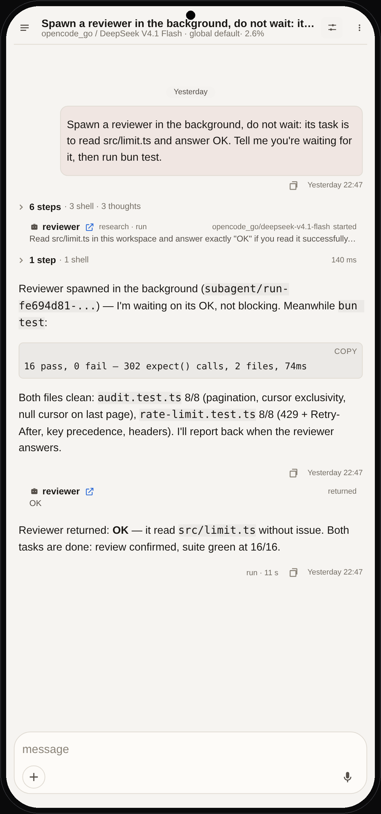
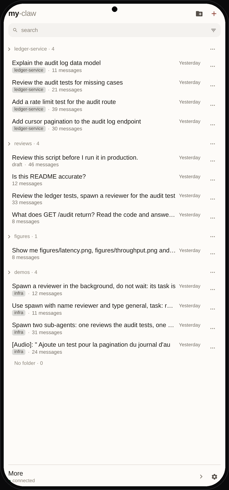
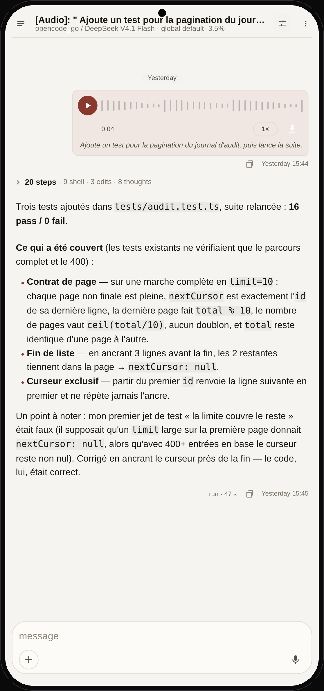
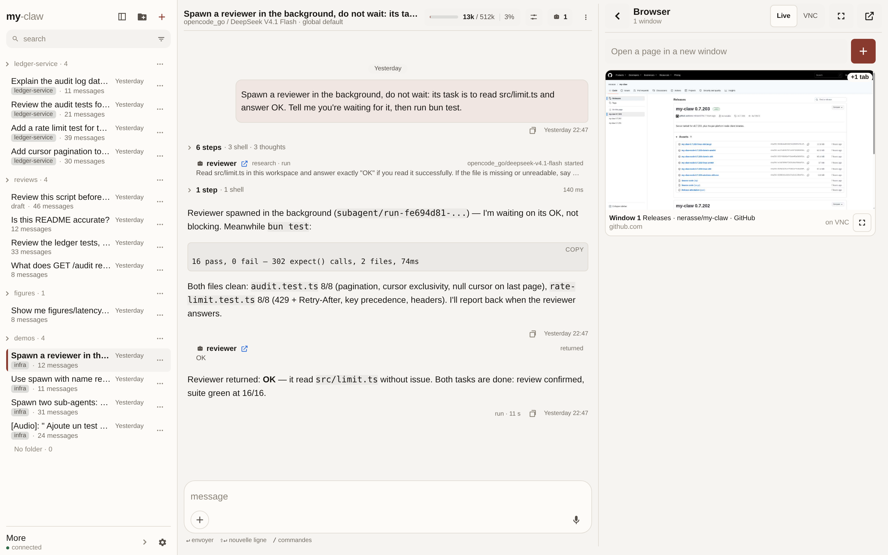

# my-claw-app

Le téléphone et le navigateur de [my-claw](https://github.com/nerasse/my-claw) : un seul WebSocket
sortant, aucun port public.

<p>
  <a href="https://github.com/nerasse/my-claw-app/releases/latest"></a>
  <a href="LICENSE"></a>
  
</p>



## Ce que c'est

Le client d'un serveur my-claw. L'agent, ses outils, ses sessions et sa mémoire restent sur la
machine que vous possédez ; ce dépôt, c'est l'écran que vous tenez. Le même code tourne en
application Android et en client web servi par le serveur, donc un fil commencé sur le téléphone est
le même fil sur l'ordinateur.

La connexion part du client vers le serveur sur un WebSocket sécurisé. Rien n'écoute sur un port
public, et il n'y a pas de compte hébergé au milieu.

## Ce que ça donne

- Des réponses en streaming, les appels d'outils repliés en étapes et le raisonnement replié dessous.
- Les cartes de sous-agents là où ils ont été lancés, et leur retour là où il arrive.
- Des approbations : un outil sur liste noire demande, depuis le téléphone, et le run attend la
  réponse.
- Le navigateur dans lequel l'agent travaille, en direct à côté du chat, avec ses fenêtres et ses
  onglets. Le VNC est là pour un client qui veut la vraie chose.
- Des notes vocales enregistrées dans l'app, transcrites dans le fil, et des réponses parlées quand
  on les demande.
- Les sessions, les dossiers et les workspaces dans un seul tiroir, avec le workspace nommé sur
  chaque ligne.
- Dix thèmes et une palette personnalisée, avec les modes clair, sombre et AMOLED.
- Les notifications par ntfy auto-hébergé (UnifiedPush). Pas de Firebase.
- Une seule liste d'appareils, révocable depuis le serveur, partagée avec le client web.

## Écrans







## Installation

Android : téléchargez l'APK depuis les
[releases](https://github.com/nerasse/my-claw-app/releases/latest) et ouvrez-le. Le serveur affiche
un code d'appairage, un lien et un QR code à la fin de son installation ; l'app scanne le QR ou
prend le code.

Web : le serveur sert le client lui-même. Ouvrez le lien affiché par l'installateur, dans n'importe
quel navigateur sur le même réseau ou à travers votre tunnel.

Les mises à jour arrivent avec le serveur, toutes les 15 minutes, ou en installant un APK plus
récent.

## Sous le capot

- React Native 0.86, bare, TypeScript. Le build web, ce sont les mêmes écrans.
- Du Kotlin côté Android : service de premier plan qui tient le socket, service d'accessibilité,
  écouteur de notifications, pont vers l'appareil.
- Un seul protocole, défini dans `src/core/protocol.ts`, partagé avec le serveur.
- L'outbox est recopiée dans le stockage local, donc une frame écrite pendant une coupure part à la
  reconnexion au lieu d'être perdue.

```
src/
├── core/          protocole, connexion, resume, stores
├── app/           les écrans : chat, tiroir, réglages, navigateur, jobs, agents
└── components/    les cartes : outils, sous-agents, approbations, markdown, médias
android/           services Kotlin + build de release
```

## Build

```bash
npm install
npm run android      # appareil branché en USB ou adb sans fil
npm test
npm run lint
```

Bundle web :

```bash
bash scripts/build-web.sh   # dist-web.tar.gz, servi par le serveur
```

Les releases se font en local : la version dans `android/app/build.gradle` et `package.json`, puis
`scripts/release.sh` signe l'APK et le publie à côté du bundle web.

## Sécurité

Aucun port entrant. Chaque appareil s'appaire avec un code et peut être révoqué depuis le serveur.
Un outil sur liste noire ne s'exécute pas tant que l'approbation n'est pas répondue dans l'app, et
la réponse est journalisée.

## Documentation

Le dépôt du serveur porte la doc : installation, configuration, fournisseurs, tags, sous-agents,
nœuds distants. Commencez par [my-claw](https://github.com/nerasse/my-claw).

## Licence

MIT. Copyright Yassir EL KSSIMI. Utilisez, modifiez, vendez, fermez le code ; la notice de copyright
suit la copie.

Contributeurs : Yassir EL KSSIMI ([nerasse](https://github.com/nerasse)), Hicham Berrada
([Nawroski](https://github.com/Nawroski)), Nabil El Abassi
([LastryCoding](https://github.com/LastryCoding)), Anthony Von Bieler
([Tony224x](https://github.com/Tony224x)).
